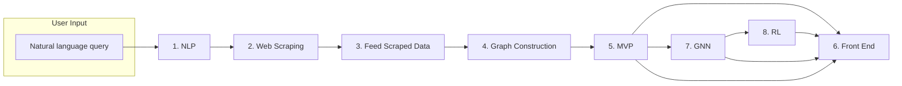

# Project-RoadmapGenerationModel

An end-to-end research pipeline for generating personalized travel roadmaps in Sri Lanka. The project collects tour and safari data from the web, enriches it with NLP, builds knowledge graphs, and progressively improves recommendations through rule-based baselines, Graph Neural Networks (GNN), and Reinforcement Learning (RL).

> **Disclaimer:** The data, information, and methods in this repository are for **research purposes only**. Not for commercial use.

---

## Pipeline Overview

The project is organized as eight sequential stages. Each numbered folder builds on the output of the previous one.



| Stage | Folder | Purpose |
|-------|--------|---------|
| 1 | `1. NLP` | Parse user intent, extract entities, and generate embeddings |
| 2 | `2. Web Scraping` | Collect raw tour/safari/beach listings from TripAdvisor |
| 3 | `3. Feed Scraped Data` | LLM-based feature extraction and data enrichment |
| 4 | `4. Graph Construction` | Build a NetworkX knowledge graph from enriched tours |
| 5 | `5. MVP` | Rule-based roadmap generation and geospatial matching |
| 6 | `6. Front End` | Streamlit and Next.js user interfaces |
| 7 | `7. GNN` | Graph Neural Network for link prediction and recommendations |
| 8 | `8. RL` | Reinforcement learning policy for ranking and sequencing tours |

---

## Folder Details

### 1. NLP — Natural Language Processing

Explores NLP techniques for understanding travel-related user queries.

| File | Description |
|------|-------------|
| `NLP Tasks.ipynb` | Core pipeline: text cleaning, rule-based intent detection, spaCy NER, KeyBERT keyword extraction, and MiniLM sentence embeddings |
| `NLP using deepseek API.ipynb` | LLM-based NER and intent classification via DeepSeek (OpenRouter) |
| `GPT_implementation.ipynb` | Text generation experiments with GPT-2 |

**Key capabilities:**
- Intent detection (e.g. "Travel Roadmap Generation")
- Named entity extraction (locations, dates)
- 384-dimensional embeddings via `all-MiniLM-L6-v2`

---

### 2. Web Scraping — Data Collection

Scrapes Sri Lanka travel listings from TripAdvisor using `requests`, `BeautifulSoup`, and session-based pagination.

| Output | Description |
|--------|-------------|
| `sri_lanka_safaris.csv` / `.json` | Safari and wildlife tour listings |
| `sri_lanka_beaches.csv` | Beach destination listings |
| `sri_lanka_private_tours.csv` | Private tour listings |

| Notebook | Focus |
|----------|-------|
| `test5_safari.ipynb` | Main safari scraper with paginated TripAdvisor extraction |
| `test7_beaches.ipynb` | Beach listings scraper |
| `test9_productReview.ipynb` | Product review scraping |
| `test1.ipynb` – `test4.1.ipynb` | Scraper prototyping and HTML parsing tests |

Each record typically includes: title, image links, rating, reviews, tour type, duration, description, and starting price.

---

### 3. Feed Scraped Data — Feature Enrichment

Transforms raw scraped JSON into structured, feature-rich tour objects using LLMs.

| Notebook | LLM Backend |
|----------|-------------|
| `Feed deepseek.ipynb` | DeepSeek via OpenRouter API |
| `feed test 2.ipynb` | Local Ollama models |
| `test3.ipynb` | DeepSeek with strict JSON output |

**Extracted features** (stored under `extracted_features`):

- `park_names`, `primary_wildlife_focus`, `safari_type_detail`
- `suitability`, `duration_category`, `price_category`
- `key_attractions`, `flexibility_notes`
- `district`, `latitude`, `longitude` (added in enhanced datasets)

| Output | Description |
|--------|-------------|
| `sri_lanka_safaris_with_features.json` | Full enriched dataset (~1000+ items) |
| `sri_lanka_safaris_enhanced_regex.json` | Regex-assisted enrichment variant |
| `sri_lanka_safaris_3_items.json` | Small sample sets for testing |

---

### 4. Graph Construction — Knowledge Graph

Builds a heterogeneous graph from enriched tour data using NetworkX.

| Notebook | Description |
|----------|-------------|
| `test1_graph_construction.ipynb` | Graph creation and matplotlib visualization |
| `test3_roadmap_logic.ipynb` | Query-driven subgraph extraction and roadmap logic |
| `test2.ipynb` | Additional graph experiments |

**Node types:** `tour`, `location`, `wildlife`, `safari_type`, `attraction`, `duration`, `price`

**Edge relations:** `located_in`, `has_focus`, `has_type`, `has_attraction`, `has_duration`, `has_price`

**Query functions:**
- `get_tours_by_tag()` — find tours by wildlife or attraction
- `get_tours_by_location()` — find tours by national park
- `get_custom_roadmap()` — combine focus + safari type filters
- `visualize_subgraph()` — render relevant subgraphs for a user query

---

### 5. MVP — Rule-Based Roadmap Generator

Minimum viable product using heuristic matching without ML training.

| Notebook | Approach |
|----------|----------|
| `test1_rule_based.ipynb` | Group tours by wildlife category, sort by rating |
| `test2_rule_based.ipynb` | Category-based roadmap assembly |
| `test3_rule_based.ipynb` | Geospatial matching by Sri Lankan district |
| `test4_RB_with_userPrompt.ipynb` | Full pipeline: NER from user query → district extraction → proximity ranking → NetworkX graph visualization |

**Logic:**
1. Parse user query for district names (Gampaha, Kandy, Yala, etc.)
2. Compute geodesic distance from user location to each tour
3. Return top-k matching safaris as a day-by-day roadmap
4. Visualize the selected route as an interactive graph

| Data | Items |
|------|-------|
| `safaris_10_items_enhanced.json` | 10-tour sample |
| `safaris_20_items_enhanced.json` | 20-tour sample |
| `safaris_30_items_enhanced.json` | 30-tour sample with full geo features |

---

### 6. Front End — User Interfaces

Two prototype frontends for interacting with the roadmap generator.

#### Streamlit (`rm_streamlit/app.py`)

- Text input for destination, trip type, and budget
- Generates a multi-day itinerary
- Embeds an interactive PyVis/NetworkX graph visualization

```bash
cd "6. Front End/rm_streamlit"
streamlit run app.py
```

#### Next.js (`rm_nextjs/`)

- React 19 + Next.js 15 + Tailwind CSS 4 scaffold
- TypeScript project ready for API integration with the backend pipeline

```bash
cd "6. Front End/rm_nextjs"
npm install
npm run dev
```

---

### 7. GNN — Graph Neural Network Recommendations

Trains a Graph Convolutional Network (GCN) for link prediction and tour recommendation using PyTorch Geometric.

| File | Description |
|------|-------------|
| `test1.ipynb` | Initial GCN link predictor on 30 items |
| `test2 with 30 items.ipynb` | Refined training with district-based recommendations |
| `test3 with 1000 items.ipynb` | Scaled training on full dataset with ROC/AUC evaluation |
| `gnn_model.pt` | Trained GCN model weights |
| `model_artifacts.pkl` | Node index, TF-IDF vectorizer, scaler, and metadata |

**Graph structure:**
- **Safari nodes** — numeric features (lat, lon, rating, log-reviews) + TF-IDF description vectors + multi-hot tags
- **Location nodes** — district-level nodes connected to safaris
- **Edges** — safari ↔ location, safari ↔ safari (shared tags / proximity)

**Model:** `GCNLinkPredictor` — 2-layer GCN with dot-product link decoder

**Training:** Random link split, negative sampling, early stopping on validation AUC

**Inference:** `get_safari_recommendations(query_text, query_tags, num_recommendations)` — returns ranked safaris based on learned embeddings

---

### 8. RL — Reinforcement Learning Ranking

Combines GNN embeddings with a policy network to optimize tour selection sequences.

| File | Description |
|------|-------------|
| `GNN_RL.ipynb` | Loads trained GNN model and artifacts; sets up embedding-based candidate pool |
| `ner.ipynb` | DeepSeek-powered NER extraction from user prompts (locations, dates) |
| `gnn_model.pt` / `model_artifacts.pkl` | Copied GNN artifacts for RL pipeline |
| `safaris_30_items_enhanced.json` | Evaluation dataset |

**Approach (REINFORCE):**
1. Encode user query via NER → structured JSON (wildlife focus, locations, dates)
2. Retrieve GNN candidate embeddings nearest to the query
3. **Policy network** selects K tours sequentially from the candidate pool
4. **Reward function** combines:
   - Wildlife relevance match (+2.0)
   - Normalized tour rating (+0–1.0)
   - Park diversity bonus (+0.1) / duplicate penalty (−0.3)
5. Train policy with REINFORCE to maximize cumulative reward

> **Note:** A more complete RL implementation with training loops and evaluation is also available in `zzz/gnn_rl.ipynb` for reference.

---

## Getting Started

### Prerequisites

- Python 3.10+
- Node.js 18+ (for Next.js frontend)
- CUDA-capable GPU recommended for GNN/RL training (CPU works for inference)
- API keys: `OPENROUTER_API_KEY` in a `.env` file (for DeepSeek LLM calls)

### Python Setup

```bash
python -m venv .venv

# Windows
.venv\Scripts\activate

# macOS / Linux
source .venv/bin/activate

pip install -r requirements.txt
python -m spacy download en_core_web_sm
```

### Environment Variables

Create a `.env` file in the project root:

```env
OPENROUTER_API_KEY=your_openrouter_api_key_here
```

### Recommended Workflow

1. Run notebooks in `1. NLP` to validate query parsing
2. Scrape or use existing data from `2. Web Scraping`
3. Enrich data via `3. Feed Scraped Data/Feed deepseek.ipynb`
4. Build the knowledge graph in `4. Graph Construction/test3_roadmap_logic.ipynb`
5. Test rule-based roadmaps in `5. MVP/test4_RB_with_userPrompt.ipynb`
6. Train the GNN in `7. GNN/test3 with 1000 items.ipynb`
7. Fine-tune ranking with RL in `8. RL/GNN_RL.ipynb`
8. Launch the Streamlit demo from `6. Front End`

---

## Key Dependencies

| Category | Libraries |
|----------|-----------|
| NLP | spaCy, NLTK, KeyBERT, sentence-transformers, transformers |
| Scraping | BeautifulSoup4, requests, Crawl4AI, Playwright |
| LLM | OpenAI SDK (OpenRouter), Ollama, LiteLLM |
| Graphs | NetworkX, PyVis, torch-geometric |
| ML | PyTorch, scikit-learn, pandas, numpy |
| Visualization | matplotlib, Streamlit, Altair |
| Frontend | Next.js, React, Tailwind CSS |

See [`requirements.txt`](requirements.txt) for the full pinned dependency list.

---

## Data Schema (Enriched Tour)

```json
{
  "title": "Private Jeep Safari at Minneriya National Park",
  "rating": "4.9",
  "total_reviews": "222",
  "type": "4WD Tours",
  "travel_duration": "3–4 hours",
  "description": "...",
  "starting_price": "$35",
  "extracted_features": {
    "park_names": ["Minneriya National Park"],
    "primary_wildlife_focus": "Elephants",
    "safari_type_detail": "Private Jeep Safari",
    "suitability": "General",
    "duration_category": "Half-Day",
    "price_category": "Budget",
    "key_attractions": ["Elephants"],
    "flexibility_notes": "Weather-dependent",
    "district": "Polonnaruwa",
    "latitude": "7.9734° N",
    "longitude": "80.9996° E"
  }
}
```

---

## Project Structure

```
Project-RoadmapGenerationModel/
├── 1. NLP/                          # Query understanding & embeddings
├── 2. Web Scraping/                 # TripAdvisor data collection
├── 3. Feed Scraped Data/            # LLM feature extraction
├── 4. Graph Construction/           # NetworkX knowledge graph
├── 5. MVP/                          # Rule-based roadmap generator
├── 6. Front End/
│   ├── rm_streamlit/                # Streamlit demo app
│   └── rm_nextjs/                   # Next.js web app scaffold
├── 7. GNN/                          # Graph Neural Network training
├── 8. RL/                           # Reinforcement learning ranking
├── requirements.txt
└── README.md
```

---

## License & Usage

This repository is intended for academic and research use. Do not use scraped TripAdvisor data or trained models for commercial purposes without appropriate licensing and permissions.
